# System Architecture

## 1. High-Level Architecture Overview

The system is architected as a modular, monolithic **NestJS** application structured around clean separation of concerns, asynchronous job offloading via **BullMQ**, MongoDB persistence via **Prisma ORM**, and multi-level caching via **Redis**.

```mermaid
flowchart TD
    subgraph Clients
        WebClient["Web / Mobile App"]
        AdminDashboard["Admin Dashboard"]
        LoadTestHarness["Load Testing Client"]
    end

    subgraph Entrypoint ["NestJS Gateway & Middleware"]
        HTTPGateway["Express HTTP Gateway (Port 8000)"]
        Swagger["Swagger UI (Tiered: Admin / Web / System)"]
        BullBoardUI["Bull-Board UI (/admin/queues)"]
        LoggingInter["Winston Request Logger"]
        RespInter["Global Response Interceptor"]
        ExcFilter["AllExceptionsFilter"]
    end

    subgraph ApplicationModules ["Modular Domain Services"]
        WebMod["WebModule\n(Auth, Products, Cart, Order, User)"]
        AdminMod["AdminModule\n(Auth, Products, User)"]
        SysMod["SystemModule\n(Health Probes, Queue Ops)"]
        QueueMod["QueueModule\n(Producers, Workers, Services)"]
    end

    subgraph CachingLayer ["Caching Subsystem"]
        HybridCache["HybridCacheService (L1 Memory / L2 Redis)"]
        PageCache["PaginationSnapshotService"]
        RedisSvc["RedisService (ioredis)"]
    end

    subgraph DataStorage ["Data & Message Stores"]
        MongoDB[("MongoDB (Prisma ORM)")]
        Redis[( "Redis (Queue Engine & Cache Storage)")]
    end

    subgraph QueueWorkers ["BullMQ Worker Fleet"]
        CriticalWorker["Critical Worker (Conc: 10)"]
        NormalWorker["Normal Worker (Conc: 30)"]
        BulkWorker["Bulk Worker (Conc: 100)"]
        RetryWorker["Retry Worker (Conc: 30)"]
    end

    subgraph NotificationEngine ["Resilient Notification Subsystem"]
        EmailService["EmailSenderService\n(Circuit Breaker + Fallback)"]
        SES["AWS SES"]
        SendGrid["SendGrid"]
        Mailgun["Mailgun"]
    end

    Clients --> HTTPGateway
    HTTPGateway --> LoggingInter --> RespInter --> ExcFilter
    RespInter --> ApplicationModules
    
    WebMod & AdminMod --> MongoDB
    WebMod & AdminMod --> CachingLayer
    CachingLayer --> Redis
    
    SysMod & WebMod --> QueueMod
    QueueMod -->|Enqueue with Idempotency| Redis
    Redis --> QueueWorkers
    QueueWorkers --> EmailService
    EmailService --> SES
    SES -.->|Failover| SendGrid
    SendGrid -.->|Failover| Mailgun
```

---

## 2. Layered Architecture

The application enforces a 4-tier layered architecture:

```
┌────────────────────────────────────────────────────────┐
│             Presentation & Routing Layer               │
│  Controllers, DTOs, Route Guards, Swagger Decorators   │
├────────────────────────────────────────────────────────┤
│                Domain & Business Layer                 │
│  Injectable Services, Business Validation, Operations  │
├────────────────────────────────────────────────────────┤
│                 Data Access Layer (DAL)                │
│  PrismaService, MongoDB Schema Models, Transactions    │
├────────────────────────────────────────────────────────┤
│            Infrastructure & Messaging Layer            │
│  BullMQ Queues, Redis Caching, Winston File Rotation   │
└────────────────────────────────────────────────────────┘
```

1. **Presentation Layer**:
   - NestJS Controllers grouped under feature modules (`admin`, `web`, `system`).
   - Decorated with `AuthRole`, `Pagination`, and Swagger annotations.
   - Guarded by `AuthGuard` (JWT validation) and `RoleGuard` (RBAC enforcement).
2. **Domain Layer**:
   - Feature services executing core business rules (e.g., `OrderService`, `CartService`, `EmailProducer`).
   - Completely agnostic of the underlying HTTP delivery mechanism.
3. **Data Access Layer**:
   - `PrismaService` maintaining a singleton connection to MongoDB.
   - Fully typed queries generated via `@prisma/client`.
4. **Infrastructure Layer**:
   - `RedisService` for cache operations, atomic locking, and pipeline execution.
   - `WorkerFactory` dynamically instantiating BullMQ worker instances.
   - Winston transport handlers routing logs to console and rotating disk files.

---

## 3. Module Hierarchy & Dependencies

```mermaid
graph TD
    AppModule["AppModule (Root)"]
    
    AppModule --> WebModule
    AppModule --> AdminModule
    AppModule --> SystemModule
    AppModule --> QueueModule
    AppModule --> SharedModule
    
    subgraph WebModuleScope [Web Module]
        WebModule --> WebAuth[AuthModule]
        WebModule --> WebUser[UserModule]
        WebModule --> WebProducts[ProductsModule]
        WebModule --> WebCart[CartModule]
        WebModule --> WebOrder[OrderModule]
        WebModule --> WebSpecs[SpecificationsModule]
    end

    subgraph AdminModuleScope [Admin Module]
        AdminModule --> AdminAuth[AuthModule]
        AdminModule --> AdminUser[UserModule]
        AdminModule --> AdminProducts[ProductsModule]
    end

    subgraph SystemModuleScope [System Module]
        SystemModule --> HealthModule[Terminus Health Probes]
        SystemModule --> SystemController[Queue Controls & Load Test]
    end

    subgraph QueueModuleScope [Queue Module]
        QueueModule --> EmailProducer
        QueueModule --> EmailSenderService
        QueueModule --> DlqReplayService
        QueueModule --> WorkerFactory
        QueueModule --> BullBoardModule
    end
```



---

## 4. Distributed Queue & Worker Architecture

The queue architecture is designed to handle high loads (1M+ jobs) without starvation of critical tasks or Redis memory exhaustion.

### 4.1. Queue Topology

```
                  ┌────────────────────────────────────────────────────────┐
                  │                 EmailProducer (Enqueue)                │
                  └───────────────────────────┬────────────────────────────┘
                                              │
         ┌────────────────────────────────────┼───────────────────────────────────┐
         │ (10%)                              │ (45%)                             │ (45%)
         ▼                                    ▼                                   ▼
┌──────────────────┐                ┌──────────────────┐                ┌──────────────────┐
│  email-critical  │                │   email-normal   │                │    email-bulk    │
│  Conc: 10        │                │   Conc: 30       │                │    Conc: 100     │
│  Limit: 100/s    │                │   Limit: 50/s    │                │    Limit: 2000/s │
└────────┬─────────┘                └────────┬─────────┘                └────────┬─────────┘
         │                                   │                                   │
         └───────────────────────────────────┼───────────────────────────────────┘
                                             │
                                   Worker Processing
                                             │
                                    (All Providers Fail)
                                             │
                                             ▼
                             ┌───────────────────────────────┐
                             │       worker.on('failed')     │
                             └───────────────┬───────────────┘
                                             │
                 ┌───────────────────────────┴───────────────────────────┐
                 │ Transient Failure & Attempts < 5                      │ Permanent Bounce / Attempts >= 5
                 ▼                                                       ▼
      ┌──────────────────────┐                                ┌──────────────────────┐
      │     email-retry      │                                │      email-dlq       │
      │  Conc: 30            │                                │  Passive Storage     │
      │  Exponential Backoff │                                │  Inspection & Replay │
      │  Priority Segregated │                                └──────────────────────┘
      └──────────────────────┘
```

### 4.2. Ingestion Backpressure Engine
- **Threshold**: Set at `REDIS_BACKPRESSURE_LIMIT = 50,000` waiting jobs.
- **Mechanism**: The batch seeder polls the length of waiting jobs before each 10k insertion batch. If waiting jobs exceed 50k, the ingestion loop sleeps for 2 seconds.
- **Guarantee**: Redis RAM remains bounded between 80MB and 180MB, even when 1,000,000 jobs are triggered.

---

## 5. Caching Subsystem Architecture

The application employs a multi-strategy caching engine:

1. **Hybrid Cache (`HybridCacheService`)**:
   - **L1 (In-Memory)**: High-speed local cache for volatile, extremely frequent queries.
   - **L2 (Redis Distributed)**: Shared persistence cache with deterministic TTLs across horizontal instances.
2. **Pagination Snapshotting (`PaginationSnapshotService`)**:
   - Caches pre-computed paginated ID windows to avoid expensive `$skip` / `$limit` operations across large MongoDB collections.
3. **Structured Cache Keys (`CacheKeyService`)**:
   - Uniform key formatting: `<prefix>:<entity>:<identifier>:<query-hash>`.

---

## 6. Resilience & Fault-Tolerance Architecture

1. **Third-Party Provider Circuit Breaker**:
   - Tracks consecutive failures across `SES`, `SendGrid`, and `Mailgun`.
   - If a provider triggers 3 sequential failures, its circuit trips into `UNHEALTHY` state for 15 seconds.
2. **Outage Detection & Queue Self-Healing**:
   - If all providers fail concurrently, the worker pauses the active queue for 15 seconds to prevent hammering downstream external APIs.
3. **Dead-Letter Queue (DLQ) & Replay Engine**:
   - Permanent errors (e.g. invalid domain, bounce) immediately bypass retries to `email-dlq`.
   - `DlqReplayService` provides automated or administrative replay back into the originating queues.

---

## 7. Technology Stack Reference

| Component | Technology | Role |
| :--- | :--- | :--- |
| **Runtime** | Node.js (v20+) | Fast, asynchronous JavaScript server runtime |
| **Framework** | NestJS (v10.3) | TypeScript enterprise architecture framework |
| **Database** | MongoDB | Document database for catalog, users, orders |
| **ORM** | Prisma (v5.9) | Type-safe database client and migrations |
| **Cache & Queue Broker** | Redis / ioredis (v5.10) | In-memory data store for queues, locks, and cache |
| **Queue Manager** | BullMQ (v11.0) | Distributed priority message queue |
| **Dashboard** | Bull-Board (v7.1) | Live visual monitoring for BullMQ queues |
| **Logging** | Winston (v3.19) + Rotate | Structured rotation logging to disk and stdout |
| **API Docs** | Swagger / OpenAPI | Interactive API documentation |
| **Health Checks** | NestJS Terminus (v11.1) | Production health and readiness probes |
