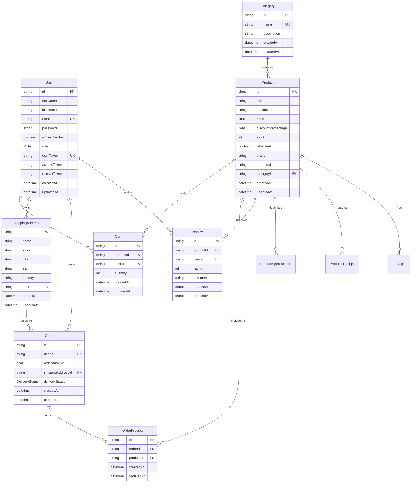

# System & Component Design

## 1. Database Schema & Data Models (Prisma MongoDB)

The database persistence layer is modeled using Prisma ORM with MongoDB. Below is the Entity-Relationship Diagram representing the application domain.



---

## 2. Core Architectural & Design Patterns

### 2.1. Dynamic Worker Factory Pattern
Located at `src/modules/queue/core/worker.factory.ts`. Instead of manually duplicating BullMQ worker setup code across distinct queues, the `WorkerFactory` provides a standardized factory method:
- Instantiates workers with unified BullMQ connection configurations.
- Injects a standard execution delegate (`EmailProcessor.process()`).
- Binds uniform lifecycle listeners: `completed`, `failed`, `active`, and `error`.
- Encapsulates automatic retry calculation and DLQ routing logic upon job failure.

### 2.2. Chain-of-Responsibility / Fallback Pattern
Located at `src/modules/queue/services/email-sender.service.ts`.
- Manages an array of third-party email providers: `[SES, SendGrid, Mailgun]`.
- Attempts delivery via the primary provider (`SES`).
- If a provider fails or its circuit is open, execution falls through to the next provider in the chain.
- If all providers fail, a comprehensive failure error is thrown, triggering the outage circuit breaker.

### 2.3. Decorator Pattern
- `@AuthRole(Role.admin)`: Attaches metadata specifying role prerequisites.
- `@Pagination()`: Automatically extracts and sanitizes query parameters (`page`, `limit`, `sort`, `search`).
- `@ProductFilter()`: Parses dynamic catalog filters (category, price range, brand).

### 2.4. Interceptor & Filter Pattern
- `ResponseInterceptor`: Enforces uniform output structure across all controller methods.
- `AllExceptionsFilter`: Normalizes all unhandled exceptions, translating database or system errors into safe, client-facing JSON responses.

---

## 3. API Contract & Response Envelope Design

All HTTP endpoints adhere strictly to a standard envelope structure:

### 3.1. Successful Response
```json
{
  "success": true,
  "statusCode": 200,
  "message": "Operation completed successfully.",
  "data": {
    "id": "671aa5f0e1c2d3a4b5c6d7e8",
    "email": "user@example.com",
    "role": "user"
  },
  "timestamp": "2026-10-25T18:30:00.000Z"
}
```

### 3.2. Error Response
```json
{
  "success": false,
  "statusCode": 400,
  "message": "Validation failed: 'email' must be an email address.",
  "error": "Bad Request",
  "timestamp": "2026-10-25T18:30:00.000Z"
}
```

---

## 4. Distributed Queue & Load-Test Design

### 4.1. Idempotency Lock Specification
To prevent duplicate job dispatch (e.g. rapid OTP requests or repeated load tests):
- Key format: `idempotency:email:<emailType>:<userId|to>`
- Acquisition command: `SET key 1 EX <ttl> NX`
- In `enqueueBulk()`, lock evaluations are bundled into a single **Redis pipeline** command batch. If a lock key is already present in Redis, the job is dropped immediately prior to queue insertion.

### 4.2. Ingestion Backpressure Algorithm
To protect Redis from memory exhaustion during massive 1,000,000 job load tests:
```typescript
while (waitingBulk > REDIS_BACKPRESSURE_LIMIT || waitingNormal > REDIS_BACKPRESSURE_LIMIT) {
    this.logger.warn(`[BACKPRESSURE] Queue load high. Waiting 2s...`);
    await new Promise((resolve) => setTimeout(resolve, 2000));
    waitingBulk = await this.bulkQueue.getWaitingCount();
    waitingNormal = await this.normalQueue.getWaitingCount();
}
```
- `REDIS_BACKPRESSURE_LIMIT` is strictly pinned to **50,000**.
- The ingestion process dynamically syncs with the worker drain rate.

### 4.3. Exponential Retry Backoff & DLQ Routing
When an email transmission fails with a transient error:
$$\text{delay} = \min(30000, 1000 \times 2^{\text{attempts}}) + \text{jitter}(0\text{--}1000\text{ ms})$$
- The job is dispatched to `email-retry` with the computed delay and its original priority score.
- When `globalAttemptsMade >= 5` or when the error is classified as **Permanent** (e.g., recipient mailbox does not exist), the job is transferred to `email-dlq` without further retries.

---

## 5. Security & Authentication Architecture

1. **Password Security**:
   - Encrypted with `bcrypt` using 10 salt rounds before storage.
2. **JWT Lifecycle**:
   - Access Token: Short expiration (e.g., 15 minutes) carrying `userId`, `email`, and `role`.
   - Refresh Token: Long-lived token stored hashed in MongoDB to facilitate token rotation.
3. **Guard Execution Pipeline**:
   ```
   Incoming Request ──► AuthGuard (Verify Bearer JWT) ──► RoleGuard (Validate User Role) ──► Controller Handler
   ```
