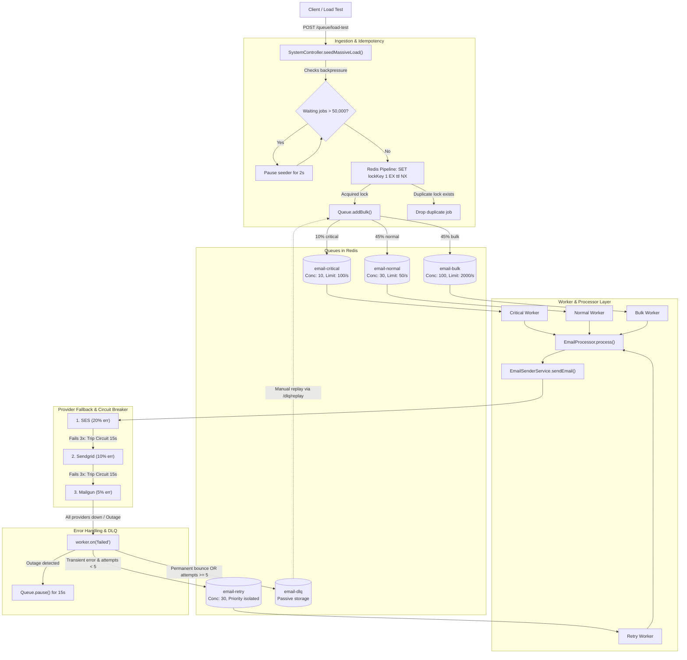

# Job Queue Execution Flow & 1M Load Test Behavior

This document details the jobs workflow, architecture components, and end-to-end behavior of the queue system when subjected to a 1,000,000 jobs load test.

---

### 1. Architecture & Jobs Workflow Overview

The job queue system is built on **NestJS** and **BullMQ** (powered by Redis). It follows a multi-tier queue architecture with priority segregation, idempotency guards, backpressure regulation, provider-level circuit breakers, exponential retry backoff, and dead-letter handling.

#### End-to-End Workflow Diagram



---

### 2. Core Workflow Components

1. **Producer & Idempotency** ([`EmailProducer`](src/modules/queue/producers/email.producer.ts)):
   - Before queueing, an atomic Redis lock (`idempotency:email:<emailType>:<userId|to>`) is checked and set using Redis `SET lockKey 1 EX <ttl> NX`.
   - In `enqueueBulk()`, all lock acquisitions run in a single **Redis pipeline**, drastically reducing network round-trips.

2. **Segregated Queues** ([`queue.ts`](src/constants/queue.ts)):
   - `email-critical`: High priority (e.g., OTPs, password resets). Rate limited to 100/sec, worker concurrency = 10.
   - `email-normal`: Transactional (e.g., welcome emails, confirmations). Rate limited to 50/sec, worker concurrency = 30.
   - `email-bulk`: Marketing/batch emails. Rate limited to 2,000/sec, worker concurrency = 100.
   - `email-retry`: Single queue for all retrying jobs. Concurrency = 30. Uses BullMQ priority (`Critical=1`, `Normal=5`, `Bulk=10`) so critical retries always jump ahead of bulk.
   - `email-dlq`: Dead-letter storage for permanent bounces or jobs that exceeded 5 attempts.

3. **Multi-Provider Failover & Circuit Breaker** ([`EmailSenderService`](src/modules/queue/services/email-sender.service.ts)):
   - Attempts providers in waterfall order: `SES` $\rightarrow$ `Sendgrid` $\rightarrow$ `Mailgun`.
   - Each provider tracks consecutive failures. If a provider reaches 3 failures (`circuitBreakerConfig.MAX_FAILURES`), its circuit trips for 15 seconds (`unhealthyUntil = Date.now() + 15000`).

4. **Retry & DLQ Routing** ([`worker.factory.ts`](src/modules/queue/core/worker.factory.ts)):
   - Internal BullMQ retries are disabled (`attempts: 1` in `bullmqConfig`) to isolate retrying jobs from fresh jobs.
   - When all providers fail, the worker pauses the entire queue for 15s if an outage occurs, and moves the job to `email-retry` with exponential backoff + jitter:
     $$\text{delay} = \min(30000, 1000 \times 2^{\text{attempts}}) + \text{jitter}(0\text{--}1000\text{ ms})$$
   - If permanent (bounces, invalid email) or attempts $\ge 5$, the job moves to `email-dlq`.

---

### 3. How the Architecture Behaves Under a 1M Jobs Load Test

When triggering:
`POST /queue/load-test?count=1000000` handled by `SystemController.startLoadTest()`:

#### Step 1: HTTP Request Lifecycle
- The controller initiates `this.seedMassiveLoad(1000000)` as a **background promise** (`fire-and-forget` with `.catch()`).
- The HTTP request responds in **< 10ms** with `{ success: true, message: ... }`. The API will **not** timeout or block incoming web traffic.

#### Step 2: Distribution & Batch Generation
- The seeder runs in chunks of `BATCH_SIZE = 10,000` (100 total iterations).
- Every 10k batch distributes jobs as follows:
  - **10% Critical** (`globalIndex % 10 === 0`): 1,000 jobs $\rightarrow$ **100,000 total critical jobs**.
  - **45% Bulk** (`globalIndex % 2 === 0`): 4,500 jobs $\rightarrow$ **450,000 total bulk jobs**.
  - **45% Normal** (Remainder): 4,500 jobs $\rightarrow$ **450,000 total normal jobs**.

#### Step 3: Backpressure Regulation (The Safety Net)
```typescript
// SystemController.ts
while (waitingBulk > REDIS_BACKPRESSURE_LIMIT || waitingNormal > REDIS_BACKPRESSURE_LIMIT) {
    this.logger.warn(`[BACKPRESSURE] High queue load... Pausing seeder for 2 seconds...`);
    await new Promise((res) => setTimeout(res, 2000));
}
```
- `REDIS_BACKPRESSURE_LIMIT` is set to **50,000** in `queue.ts`.
- **Behavior**:
  - The first ~12 batches (~120,000 jobs) are injected rapidly via Redis pipelines within ~3–5 seconds.
  - At batch 12, `waitingBulk` and `waitingNormal` cross 50,000 ($12 \times 4,500 = 54,000$).
  - **Backpressure immediately halts the seeder loop.** The seeder sleeps in 2-second intervals, waiting for workers to drain Redis below 50,000 before allowing the next 10,000 jobs in.
  - **Result**: Redis memory will **never run Out-Of-Memory (OOM)** because Redis is never forced to hold all 1,000,000 jobs concurrently.

#### Step 4: Worker Drain Rates & Bottlenecks

Each simulated email job in `mockProviderSend()` incurs a random delay of **100ms to 600ms** (average $\approx 350\text{ms}$).

| Queue | Worker Concurrency | BullMQ Rate Limiter | Real Bottleneck | Max Realistic Drain Rate | Time for its share of 1M |
| :--- | :--- | :--- | :--- | :--- | :--- |
| **Critical** (100k) | 10 | 100/sec | Worker Concurrency ($10 / 0.35\text{s}$) | $\approx \mathbf{28.5\text{ jobs/sec}}$ | $\approx 3,500\text{s}$ (~58 mins) |
| **Normal** (450k) | 30 | 50/sec | **BullMQ Limiter (50/sec)** | $\mathbf{50\text{ jobs/sec}}$ | $\mathbf{9,000\text{s}\ (2.5\text{ hours})}$ |
| **Bulk** (450k) | 100 | 2000/sec | Worker Concurrency ($100 / 0.35\text{s}$) | $\approx \mathbf{285\text{ jobs/sec}}$ | $\approx 1,578\text{s}$ (~26 mins) |

> [!IMPORTANT]
> **The `email-normal` queue is the system's primary throughput bottleneck.**
> Because the normal queue is throttled to 50 jobs/sec, draining 4,500 normal jobs takes **~90 seconds**. The seeder will therefore unpause and enqueue a new batch only once every ~90 seconds. Consequently, **the entire 1M test will take ~2.5 hours to fully seed and process**.

#### Step 5: Circuit Breaker Cascades & Stalls
- With failure probabilities: SES (20%), Sendgrid (10%), Mailgun (5%), the probability of all 3 providers failing simultaneously is:
  $$P(\text{all fail}) = 0.20 \times 0.10 \times 0.05 = 0.001\ (0.1\%)$$
- Out of 1,000,000 jobs, ~1,000 jobs will trigger an `"All providers failed"` error.
- When this happens, `worker.factory.ts` executes:
  ```typescript
  await currentQueue.pause();
  setTimeout(async () => { await currentQueue.resume(); }, 15000);
  ```
- **Consequence**: Under 1M jobs, provider outages will repeatedly pause active queues for 15 seconds. This creates intermittent throughput freezes where active processing drops to zero until the cooldown elapses.

#### Step 6: Redis & Node.js System Health

1. **Redis Memory Footprint**:
   - BullMQ retention (`bullmqConfig`):
     - `removeOnComplete`: keep 1,000 jobs or 100s.
     - `removeOnFail`: keep 5,000 jobs or 100s.
   - Redis will only hold ~50,000 waiting jobs + ~6,000 completed/failed records + ~90,000 active idempotency keys at any given time. Total Redis RAM footprint will stay relatively low and stable (~80MB to 180MB).
2. **Node.js Logging I/O Bottleneck**:
   - `worker.on('active')`, `worker.on('completed')`, `EmailProcessor`, and `EmailSenderService` each write log lines.
   - For 1M jobs, this generates **~4 to 5 million console log lines**. Synchronous stdout writing can saturate Node.js event-loop CPU time if not redirected to an asynchronous logging sink or throttled.

---

### Summary Checklist for 1M Jobs Execution

- **Does the API crash?** No. Seeding is detached from the HTTP lifecycle.
- **Does Redis crash from OOM?** No. Backpressure pauses insertion once waiting jobs hit 50,000.
- **Do duplicate jobs enter?** No. Redis pipeline evaluates idempotency keys prior to `addBulk`.
- **How long does it take?** Approximately **2.5 hours**, strictly bounded by the 50 jobs/sec rate limiter on the `email-normal` queue.
- **What happens to failed jobs?** Transient errors route to `email-retry` (with exponential backoff and priority ordering), and exhausted/permanent failures land cleanly in `email-dlq`.
