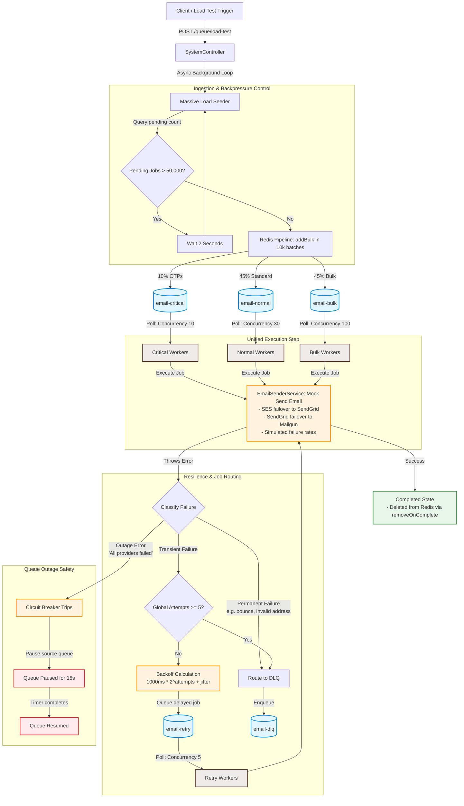

# Queue System Architecture & 1M Job Scale Plan

This document details the complete architectural design, job lifecycle transitions, priority routing, scaling strategies for 1M+ jobs, and the configuration architecture of this distributed queue system.

---

## 1. Elaborated System Flow Diagram

The diagram below outlines the system design, detailing how incoming requests are seeded, routed, processed by workers, and handled under fail conditions. The email transmission logic is consolidated into a single mock execution step.



---

## 2. In-Depth Architecture Details

### A. Scaling for 1,000,000+ Jobs (Throughput & Backpressure)
To handle a load test of 1M+ emails or other notification jobs without overwhelming Redis memory (which can cause server crashes), the ingestion flow enforces the following patterns:
1. **Batching / Pipelining**:
   Rather than performing individual database operations in a loop (which leads to 1,000,000 roundtrips), jobs are chunked into arrays of **10,000** and pushed to Redis using `addBulk`. This leverages Redis pipelining for faster ingestion speeds.
2. **Active Backpressure Throttling**:
   If jobs are pushed faster than workers can process them, the pending job queue will grow indefinitely and exceed memory capacity. To prevent this, the seeder queries the current size of the `email-bulk` queue. If the pending waiting count exceeds **50,000**, the seeder sleeps for **2 seconds** before generating the next batch.

---

### B. Priority & Queue Routing Design
Jobs are segregated into three distinct channel queues to avoid the "head-of-line blocking" problem (e.g., newsletters blocking OTP notifications):

* **`email-critical`** (Concurrency: 10, Limit: 100/sec): Used for transactional jobs (like OTPs or MFA verification) that must be processed immediately. Dedicated critical workers guarantee these execute with zero delay.
* **`email-normal`** (Concurrency: 30, Limit: 50/sec): Standard user notifications.
* **`email-bulk`** (Concurrency: 100, Limit: 200/sec): Marketing campaigns and newsletters. This queue is given a high worker concurrency pool to drain bulk jobs in parallel, but it is heavily throttled via rate limits to prevent provider rate-limit limits or outages.

---

### C. Job State Transitions

Within the BullMQ lifecycle, jobs move dynamically across states depending on execution results:

```
                  +--------+
                  | Active |
                  +---+----+
                      |
            +---------+---------+
            |                   |
       ( Success )         ( Failure )
            |                   |
            v                   v
     +------------+      +---------------+
     | Completed  |      | Error Classify|
     +------------+      +-------+-------+
     | Auto-clean |              |
     | from Redis |      +-------+-------+
     +------------+      |               |
                         v               v
                   ( Permanent )   ( Transient )
                         |               |
                         |        +------v------+
                         |        | Attempts>=5?|
                         |        +---+----+----+
                         |            |    |
                         |          (Yes) (No)
                         | <----------+    |
                         v                 |
                      +----+    +-----+    |
                      |DLQ |    |Retry| <--+
                      +----+    +-----+
```

1. **Success**: Jobs transition from `waiting` -> `active` -> `completed`. Completed jobs are automatically removed from Redis after 100 seconds to prevent resource leakage.
2. **Permanent Failures**: Failures identified as permanent (like invalid email addresses or bounces) bypass the retry logic and transition straight to `failed`, routing directly to the **Dead Letter Queue (`email-dlq`)**.
3. **Transient Failures**:
   * If the job has failed fewer than 5 times, it is placed in the **`email-retry`** queue in a `delayed` state.
   * The wait delay is calculated exponentially: `(1000ms * 2^attempts) + random_jitter`.
   * After 5 failed attempts, the job is routed to `email-dlq`.
4. **Provider Outage (Circuit Breaker)**:
   * If all mock email providers fail consecutively, the `EmailSenderService` throws an outage exception.
   * The worker catches this outage error, **pauses the source queue**, and sets a 15-second timer (`circuitBreakerConfig.CIRCUIT_OPEN_DURATION_MS`).
   * When the timer runs out, the queue is resumed, and workers pick up where they left off.

---

### D. Configuration Architecture (Global vs. Queue-Specific)

To maintain a clean separation of concerns, developer-facing settings are split:

1. **Queue-Specific Constraints (`src/constants/queue.ts`)**:
   Adjust worker concurrency and global rate-limiting throttling settings per queue.
2. **Global & Resilience Settings (`src/config/bullmq.ts`)**:
   Centralize Redis connection parameters, job lifecycle retention durations, and circuit breaker metrics (`MAX_FAILURES` and `CIRCUIT_OPEN_DURATION_MS`).
